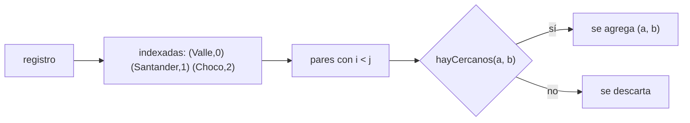
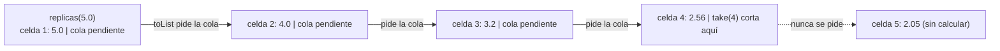

# Informe de proceso — Taller 3: consultas sobre un registro sísmico

Registro usado en las trazas (`s1` … `s7`, en orden):

| | región | magnitud |
|---|---|---|
| s1 | Valle | 4.2 |
| s2 | Santander | 5.1 |
| s3 | Valle | 3.8 |
| s4 | Choco | 6.0 |
| s5 | Santander | 4.7 |
| s6 | Valle | 5.3 |
| s7 | Choco | 3.1 |

## 1. Punto 1: expresiones `for`

### Traducción del compilador

Una expresión `for` con `yield` se traduce así:

| Forma en `for` | Operación a la que se traduce |
|---|---|
| `x <- c` (último generador) | `c.map(x => ...)` |
| `x <- c` seguido de otro generador | `c.flatMap(x => ...)` |
| `if cond` / `x <- c if cond` | `withFilter(cond)` sobre `c` |
| `(a, i) <- c` | `c.withFilter { case (a, i) => true; case _ => false }` seguido de `map`/`flatMap` con `case (a, i)` |

### `fuertes`

```scala
for (s <- r if s.magnitud > umbral) yield s.region
// r.withFilter(s => s.magnitud > umbral).map(s => s.region)
```

Ejecución con `fuertes(registro, 5.0)`:

1. `withFilter` conserva los sismos con magnitud $> 5.0$: `s2` (5.1), `s4` (6.0) y `s6` (5.3), en el orden original.
2. `map` toma la región de cada uno: `List("Santander", "Choco", "Valle")`.

No hay `distinct`, así que las regiones repetidas se conservan.

### `enRegion`

```scala
for (s <- r if s.region == region) yield s.magnitud
// r.withFilter(s => s.region == region).map(s => s.magnitud)
```

Con `enRegion(registro, "Valle")`: `withFilter` deja `s1`, `s3`, `s6`; `map` entrega `List(4.2, 3.8, 5.3)`. Con una región ausente `withFilter` no deja nada y el resultado es `List()`.

### `paresCercanos`

Tiene tres `for`.

**Regiones indexadas.**

```scala
val indexadas = (for (s <- r) yield s.region).distinct.zipWithIndex
// r.map(s => s.region).distinct.zipWithIndex
```

Para el registro: `List(("Valle", 0), ("Santander", 1), ("Choco", 2))`. El índice es la posición de primera aparición.

**`hayCercanos(a, b)`**

```scala
(for {
  x <- r if x.region == a
  y <- r if y.region == b
  if Math.abs(x.magnitud - y.magnitud) <= dif
} yield ()).nonEmpty
```

se traduce a

```scala
r.withFilter(x => x.region == a)
 .flatMap(x => r.withFilter(y => y.region == b)
                .withFilter(y => Math.abs(x.magnitud - y.magnitud) <= dif)
                .map(y => ()))
.nonEmpty
```

El generador `x` es el exterior (`flatMap`) y `y` el interior (`map`). Se produce un `()` por cada pareja $(x, y)$ que cumple la condición; la lista es no vacía si y solo si existe al menos una.

**Pareja de regiones.**

```scala
for {
  (a, i) <- indexadas
  (b, j) <- indexadas
  if i < j
  if hayCercanos(a, b)
} yield (a, b)
```

se traduce a

```scala
indexadas.withFilter { case (a, i) => true }
  .flatMap { case (a, i) =>
    indexadas.withFilter { case (b, j) => true }
      .withFilter { case (b, j) => i < j }
      .withFilter { case (b, j) => hayCercanos(a, b) }
      .map { case (b, j) => (a, b) } }
```

Ejecución con `paresCercanos(registro, 0.6)`:

| pareja $(i, j)$ | menor diferencia entre magnitudes | ¿$\le 0.6$? |
|---|---|---|
| (Valle, Santander) | $\lvert 5.3 - 5.1 \rvert = 0.2$ | sí |
| (Valle, Choco) | $\lvert 3.8 - 3.1 \rvert = 0.7$ | no |
| (Santander, Choco) | $\lvert 5.1 - 6.0 \rvert = 0.9$ | no |

Resultado: `List(("Valle", "Santander"))`. Solo se consideran los $(i, j)$ con $i < j$, de modo que cada pareja aparece una vez y con las regiones en orden de aparición.



## 2. Punto 2: agrupar con mapas

**`porRegion`** usa `groupBy(_.region)`: construye un `Map` cuyas llaves son las regiones del registro y cuyo valor es la lista de sus sismos, en el orden original.

```
Map(Valle     -> List(s1, s3, s6),
    Santander -> List(s2, s5),
    Choco     -> List(s4, s7))
```

**`conteoPorRegion`** transforma cada par `(región, sismos)` en `región -> sismos.size`: `Map(Valle -> 3, Santander -> 2, Choco -> 2)`.

**`magnitudMaxima`** transforma cada par en `región -> sismos.map(_.magnitud).max`: `Map(Valle -> 5.3, Santander -> 5.1, Choco -> 6.0)`. El `max` es seguro porque `groupBy` no crea llaves con listas vacías.

Con el registro vacío `groupBy` devuelve `Map()` y los tres resultados son `Map()`.

## 3. Punto 3: consultas seguras

- **`conteoSeguro`**: `conteoPorRegion(r).withDefaultValue(0)` envuelve el mapa; `apply` sobre una llave ausente devuelve `0` en vez de lanzar excepción. `contains` y `size` no cambian.
- **`maximaDe`**: `magnitudMaxima(r).get(region)`. `get` devuelve `Some(valor)` si la llave existe y `None` si no. Con `"Choco"`: `Some(6.0)`; con `"Amazonas"`: `None`.
- **`regionMasActiva`**:
    1. `conteoPorRegion(r).toList` → `List((Valle,3), (Santander,2), (Choco,2))` (en cualquier orden).
    2. `sortBy { case (region, n) => (-n, region) }` ordena por conteo descendente y, en empate, por nombre ascendente: `(Valle,3), (Choco,2), (Santander,2)`.
    3. `headOption` toma el primero (`None` si la lista está vacía).
    4. `map { case (region, _) => region }` deja `Some("Valle")`.

## 4. Punto 4: réplicas perezosas

```scala
def replicas(magnitud: Double): LazyList[Double] = {
  def redondear(x: Double): Double = Math.round(x * 100.0) / 100.0
  LazyList.iterate(magnitud)(_ * 0.8).map(redondear)
}
```

- `LazyList.iterate(magnitud)(_ * 0.8)` representa $m, 0.8m, 0.8^2 m, \dots$ sin calcularlos.
- `.map(redondear)` redondea cada valor a dos decimales, también de forma perezosa.

### Traza de `replicas(5.0).take(4).toList`



Cada celda se calcula cuando `toList` la pide. `take(4)` no pide la quinta, por lo que nunca se calcula. Resultado: `List(5.0, 4.0, 3.2, 2.56)`.

### Por qué no se agota la memoria

1. Cada celda de un `LazyList` guarda su cabeza y una **expresión pendiente** para la cola. Al crear `replicas(5.0)` solo existe la primera celda y la receta para el resto.
2. `take(4)` corta la secuencia en la cuarta celda sin forzar la quinta, y `toList` recorre únicamente esas cuatro. Se calculan y guardan 4 elementos, no infinitos.
3. Una secuencia infinita solo agotaría memoria si se materializara entera (por ejemplo con `toList` sin `take`). Las funciones `take` y `takeWhile` acotan el recorrido, así que el consumo es proporcional a lo pedido: $O(n)$ para $n$ elementos.

### `replicasSensibles`

`replicas(magnitud).takeWhile(_ > minimo).toList`: `takeWhile` pide celdas una a una y se detiene en la primera que no supera el mínimo; de esa celda solo se calcula el valor para compararlo, y el resto de la secuencia infinita nunca se evalúa.

Con `replicasSensibles(5.0, 3.0)`: `5.0 > 3.0` ✓, `4.0 > 3.0` ✓, `3.2 > 3.0` ✓, `2.56 > 3.0` ✗ → `List(5.0, 4.0, 3.2)`. Con `replicasSensibles(2.0, 3.0)`: `2.0 > 3.0` ✗ → `List()`.

## 5. Punto 5: informe combinado

```scala
for ((region, maxima) <- magnitudMaxima(r)) yield {
  region -> Resumen(conteo(region), maxima, replicasSensibles(maxima, minimo).size)
}
// magnitudMaxima(r).withFilter { case (region, maxima) => true }
//   .map { case (region, maxima) => region -> Resumen(...) }
```

Como el generador es un `Map` y el cuerpo devuelve un par, `map` produce otro `Map`. Con `informe(registro, 3.0)`:

| región | `conteo` | `maxima` | réplicas $> 3.0$ del sismo más fuerte | `Resumen` |
|---|---|---|---|---|
| Valle | 3 | 5.3 | 5.3, 4.24, 3.39 | `Resumen(3, 5.3, 3)` |
| Santander | 2 | 5.1 | 5.1, 4.08, 3.26 | `Resumen(2, 5.1, 3)` |
| Choco | 2 | 6.0 | 6.0, 4.8, 3.84, 3.07 | `Resumen(2, 6.0, 4)` |

Con el registro vacío `magnitudMaxima` es `Map()`, el `for` no tiene iteraciones y el resultado es `Map()`.